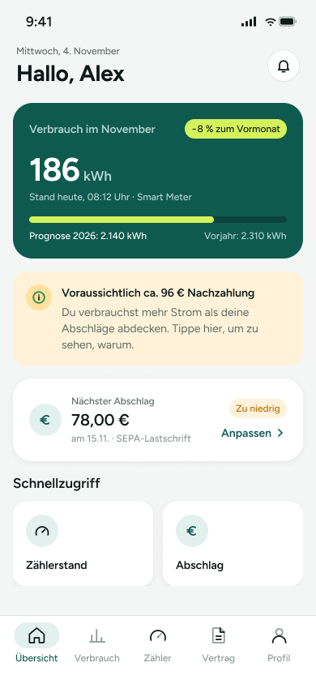

# NZ-01 – Übersicht mit Nachzahlungs-Hinweis

Übersichts-Screen der Energie-App mit aktuellem Verbrauch, Hinweis auf eine voraussichtliche Nachzahlung und dem nächsten Abschlag. Der Screen bündelt Statusinformationen und bietet Schnellzugriffe sowie die Navigation in andere App-Bereiche.

> **Datenvertrag:** Abschnitte mit 🤖 hat die KI aus dem Screen abgeleitet. Sie sind ungeprüft.
> Abschnitte mit 📐 kommen direkt aus Figma.

## Letzte Änderung (2026-11-11)

Screen neu angelegt.

## CX · Kundenerlebnis 🤖

**Journey-Moment:** Kundin sieht frühzeitig einen Hinweis auf eine mögliche Nachzahlung in der Übersicht.

**Was die Kundin erlebt:** Die Nutzerin bekommt auf einen Blick Verbrauchsdaten und einen klaren Hinweis, dass ihr aktueller Verbrauch vermutlich nicht durch die Abschläge gedeckt ist.

**Tonalität:** sachlich, informativ, leicht warnend

**Mögliche Reibungspunkte:**
- Der Hinweis auf Nachzahlung könnte verunsichern, wenn die Ursache zunächst unklar bleibt.
- Die Formulierung „Tippe hier, um zu sehen, warum.“ setzt vermutlich Erklärung voraus, die erst im nächsten Screen kommt.
- Der Status „Zu niedrig“ beim Abschlag könnte ohne Kontext erklärungsbedürftig sein.

## RE · Anforderungen

**Aktionen** 🤖
- Hinweis zur Nachzahlung antippen
- Anpassen beim Abschlag antippen
- Schnellzugriff „Zählerstand“ öffnen
- Schnellzugriff „Abschlag“ öffnen
- Über die Tab Bar zu anderen Bereichen wechseln

**Eingabefelder** 🤖
- keine

**Zustände** 🤖
- Zu sehen: Normalzustand, Hinweiszustand für voraussichtliche Nachzahlung, Quick-Action-Kacheln, aktive Tab-Bar-Ansicht Übersicht
- Vermutlich noch zu gestalten: Fehlerzustand bei fehlenden Verbrauchsdaten, Ladezustand, leerer Zustand für Schnellzugriffe, Zustand für nicht verfügbaren Smart-Meter-Wert

**Navigation** 📐
- Kommt von: –
- Führt zu: –

## BA · Geschäftsregeln 🤖

**Angezeigte Daten:**
- Datum/Uhrzeit: Mittwoch, 4. November / 9:41
- Begrüßung: Hallo, Alex
- Verbrauch im November: 186 kWh
- Abweichung: −8 % zum Vormonat
- Messstand: Stand heute, 08:12 Uhr · Smart Meter
- Prognose 2026: 2.140 kWh
- Vorjahr: 2.310 kWh
- Voraussichtlich ca. 96 € Nachzahlung
- Nächster Abschlag: 78,00 €
- Fälligkeit: am 15.11. · SEPA-Lastschrift
- Status Abschlag: Zu niedrig

**Vermutete Regeln:**
- Die Nachzahlung wird angezeigt, wenn der Verbrauch voraussichtlich höher ist als die Abschläge.
- Der Abschlag wird als „Zu niedrig“ markiert, wenn er den erwarteten Verbrauch nicht ausreichend abdeckt.
- Die Prognose vergleicht offenbar aktuellen Verbrauch mit Vorjahreswerten oder einer Jahreshochrechnung.
- Der Hinweistext führt vermutlich zu einer Erklärung im nächsten Screen.

## QA · Tests

**Testfälle** 🤖
- Screen zeigt alle genannten Werte korrekt an.
- Nachzahlungs-Hinweis wird mit Betrag und Erklärungstext dargestellt.
- Der Abschlagsbereich zeigt Betrag, Fälligkeit und Status „Zu niedrig“.
- Schnellzugriff-Kacheln sind sichtbar und eindeutig beschriftet.
- Tab Bar markiert „Übersicht“ als aktiven Bereich.
- Prüfen, ob die Anzeige bei fehlenden Smart-Meter-Daten sinnvoll ausfällt.

**Exakte Texte auf dem Screen** 📐
- 9:41
- Mittwoch, 4. November
- Hallo, Alex
- Verbrauch im November
- −8 % zum Vormonat
- 186
- kWh
- Stand heute, 08:12 Uhr · Smart Meter
- Prognose 2026: 2.140 kWh
- Vorjahr: 2.310 kWh
- Voraussichtlich ca. 96 € Nachzahlung
- Du verbrauchst mehr Strom als deine Abschläge abdecken. Tippe hier, um zu sehen, warum.
- Nächster Abschlag
- 78,00 €
- am 15.11. · SEPA-Lastschrift
- Zu niedrig
- Anpassen
- Schnellzugriff
- Zählerstand
- Abschlag
- Übersicht
- Verbrauch
- Zähler
- Vertrag
- Profil

## Dev · Umsetzung

**Komponenten aus dem Designsystem** 📐
- Status Bar
- Header/Main
- Icon Button
- Icon/Bell
- Badge
- Icon/Info
- Icon/Euro
- Icon/ChevronRight
- Quick Action
- Icon/Meter
- Tab Bar
- Tab Item
- Icon/Home
- Icon/Chart
- Icon/Document
- Icon/User

**Datenfelder** 🤖
- currentDate
- time
- userName
- currentConsumptionKwh
- consumptionChangePercent
- measurementTimestamp
- meterSource
- forecast2026Kwh
- previousYearKwh
- estimatedAdditionalPaymentEur
- nextInstallmentAmountEur
- nextInstallmentDueDate
- paymentMethod
- installmentStatus
- quickActions
- navigationTabs

**Hinweise** 🤖
- Die Werte sind offenbar aus mehreren Datenquellen kombiniert: Verbrauch, Prognose, Abschlag und Navigation.
- Der Nachzahlungs-Hinweis benötigt vermutlich einen klickbaren Bereich, auch wenn im Figma keine klickbaren Elemente markiert sind.
- Status/Label-Farben sollten dem Designsystem entsprechen.
- Tab Bar und Schnellzugriffe sollten als separate, wiederverwendbare Komponenten umgesetzt werden.

**Dev Mode:** [in Figma öffnen](https://www.figma.com/design/NpRSQ1rdXPvYjjxzDiTjBC?node-id=64-643&m=dev)

## Analytics · Messung

**Klickbare Elemente (Prototyp)** 📐
- keine Prototyp-Verbindungen in Figma

**Vorgeschlagene Events** 🤖
- view_uebersicht
- tap_nachzahlungs_hinweis
- tap_abschlag_anpassen
- tap_schnellzugriff_zaehlerstand
- tap_schnellzugriff_abschlag
- tap_tab_uebersicht
- tap_tab_verbrauch
- tap_tab_zaehler
- tap_tab_vertrag
- tap_tab_profil

**Funnel-Position** 🤖 Einstieg in den Flow „Nachzahlung frühzeitig erkennen“

## PL · Stand

| | |
|---|---|
| **Status** | beschlossen |
| **Flow** | Feature: Nachzahlung frühzeitig erkennen (Screen 1 von 2) |
| **Alle Screens im Flow** | NZ-01 – Übersicht mit Nachzahlungs-Hinweis → NZ-02 – Nachzahlung erklärt |
| **Zuletzt geändert** | 2026-11-11 |
| **Figma** | [Screen öffnen](https://www.figma.com/design/NpRSQ1rdXPvYjjxzDiTjBC?node-id=64-643) |

**Offene Fragen** 🤖
- Ist der Nachzahlungs-Hinweis vollständig klickbar oder nur der Textbereich?
- Was genau öffnet der Schnellzugriff „Abschlag“?
- Wie wird der Status „Zu niedrig“ fachlich bestimmt?
- Welche Zustände gelten, wenn kein Smart Meter vorhanden ist?
