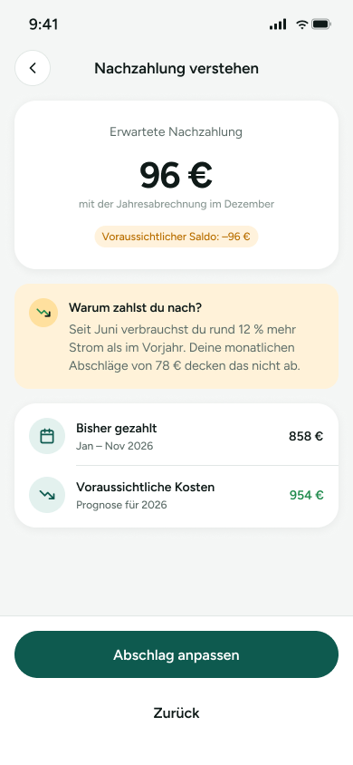

# NZ-02 – Nachzahlung erklärt

Der Screen erklärt eine erwartete Nachzahlung und zeigt, warum der Saldo voraussichtlich negativ ist. Er bietet als nächste Aktion das Anpassen des Abschlags an.

> **Datenvertrag:** Abschnitte mit 🤖 hat die KI aus dem Screen abgeleitet. Sie sind ungeprüft.
> Abschnitte mit 📐 kommen direkt aus Figma.

## Letzte Änderung (2026-11-11)

Screen neu angelegt.

## CX · Kundenerlebnis 🤖

**Journey-Moment:** Kundin erkennt eine erwartete Nachzahlung vor der Jahresabrechnung

**Was die Kundin erlebt:** Die Kundin sieht den erwarteten Betrag, eine Erklärung für die Nachzahlung und einen Hinweis auf den Zusammenhang mit Verbrauch und Abschlag.

**Tonalität:** sachlich, erklärend, leicht warnend

**Mögliche Reibungspunkte:**
- Die Höhe von 96 € könnte ohne weitere Einordnung als unklar empfunden werden.
- Die Formulierung zur Jahresabrechnung im Dezember ist vermutlich für manche Kundinnen erklärungsbedürftig.
- Die Ursache der Nachzahlung basiert auf einer Prognose und könnte als unsicher wahrgenommen werden.

## RE · Anforderungen

**Aktionen** 🤖
- Zurück navigieren
- Abschlag anpassen

**Eingabefelder** 🤖
- keine

**Zustände** 🤖
- Zu sehen: Normalzustand, Hinweis-/Erklärzustand, Zusammenfassungszustand mit Beträgen
- Vermutlich noch zu gestalten: Fehlerzustand, Ladezustand, Leerer Zustand, Abschlag-anpassen-Ergebniszustand

**Navigation** 📐
- Kommt von: –
- Führt zu: –

## BA · Geschäftsregeln 🤖

**Angezeigte Daten:**
- Erwartete Nachzahlung: 96 €
- Zeitbezug: mit der Jahresabrechnung im Dezember
- Voraussichtlicher Saldo: –96 €
- Begründung: seit Juni rund 12 % mehr Stromverbrauch als im Vorjahr
- Monatlicher Abschlag: 78 €
- Bisher gezahlt: 858 €
- Zeitraum: Jan – Nov 2026
- Voraussichtliche Kosten: 954 €
- Prognose für 2026

**Vermutete Regeln:**
- Wenn die voraussichtlichen Kosten über den bisher gezahlten Abschlägen liegen, wird eine Nachzahlung angezeigt.
- Der Hinweistext erklärt vermutlich die Differenz zwischen Verbrauch, Abschlag und Prognose.
- Der Call-to-Action führt vermutlich in einen Prozess zum Anpassen des Abschlags.

## QA · Tests

**Testfälle** 🤖
- Screen zeigt den Titel 'Nachzahlung verstehen'.
- Betrag 96 € wird im Hauptbereich korrekt angezeigt.
- Der negative Saldo wird mit Minuszeichen dargestellt.
- Der Erklärungstext zum höheren Stromverbrauch wird vollständig angezeigt.
- Die Werte in der Übersicht sind korrekt zugeordnet: 'Bisher gezahlt' und 'Voraussichtliche Kosten'.
- Der Button 'Abschlag anpassen' ist sichtbar.
- Der Textlink 'Zurück' ist sichtbar.
- Das Chevron-Icon oben links führt vermutlich zurück.

**Exakte Texte auf dem Screen** 📐
- 9:41
- Nachzahlung verstehen
- Erwartete Nachzahlung
- 96 €
- mit der Jahresabrechnung im Dezember
- Voraussichtlicher Saldo: –96 €
- Warum zahlst du nach?
- Seit Juni verbrauchst du rund 12 % mehr Strom als im Vorjahr. Deine monatlichen Abschläge von 78 € decken das nicht ab.
- Bisher gezahlt
- Jan – Nov 2026
- 858 €
- Voraussichtliche Kosten
- Prognose für 2026
- 954 €
- Abschlag anpassen
- Zurück

## Dev · Umsetzung

**Komponenten aus dem Designsystem** 📐
- Status Bar
- Header/Detail
- Icon Button
- Icon/ChevronLeft
- Badge
- Icon/TrendDown
- List Row
- Icon/Calendar
- Button

**Datenfelder** 🤖
- expectedDebtAmount
- billingMonth
- projectedBalance
- reasonText
- currentMonthlyInstallment
- paidSoFar
- periodLabel
- projectedCosts
- forecastYear

**Hinweise** 🤖
- Beträge und Prozentwert sollten aus dem Backend kommen und konsistent berechnet sein.
- Negative Werte müssen mit Vorzeichen korrekt formatiert werden.
- Die Karte mit der Erklärung und die Übersichtszeilen sind visuell getrennte Inhaltsbereiche.
- Der obere Zurück-Button und der untere Text 'Zurück' wirken wie zwei Navigationsoptionen; Verhalten abstimmen.

**Dev Mode:** [in Figma öffnen](https://www.figma.com/design/NpRSQ1rdXPvYjjxzDiTjBC?node-id=64-754&m=dev)

## Analytics · Messung

**Klickbare Elemente (Prototyp)** 📐
- keine Prototyp-Verbindungen in Figma

**Vorgeschlagene Events** 🤖
- screen_view_nachzahlung_verstehen
- click_zurueck_oben
- click_zurueck_unten
- click_abschlag_anpassen

**Funnel-Position** 🤖 2 von 2 im Flow 'Feature: Nachzahlung frühzeitig erkennen'

## PL · Stand

| | |
|---|---|
| **Status** | beschlossen |
| **Flow** | Feature: Nachzahlung frühzeitig erkennen (Screen 2 von 2) |
| **Alle Screens im Flow** | NZ-01 – Übersicht mit Nachzahlungs-Hinweis → NZ-02 – Nachzahlung erklärt |
| **Zuletzt geändert** | 2026-11-11 |
| **Figma** | [Screen öffnen](https://www.figma.com/design/NpRSQ1rdXPvYjjxzDiTjBC?node-id=64-754) |

**Offene Fragen** 🤖
- Führt 'Abschlag anpassen' direkt in eine Anpassungsmaske oder erst in einen Zwischenschritt?
- Was genau bedeutet 'mit der Jahresabrechnung im Dezember' im fachlichen Kontext?
- Ist der Text 'Zurück' unten ein sekundärer Button oder nur ein Link?
- Soll die Nachzahlung auch mit positiver/negativer Saldenlogik in anderen Fällen anders dargestellt werden?
