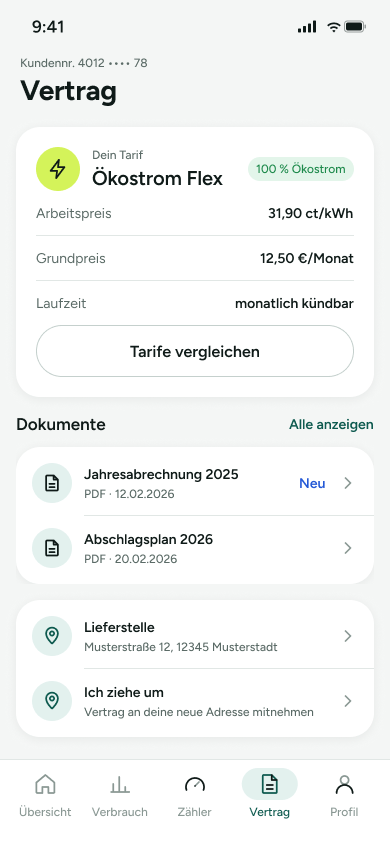

# UM-01 – Vertrag mit Umzug-Einstieg

Übersichts-Screen zum aktiven Vertrag mit Tarifdetails, Dokumenten und Umzugs-Einstieg. Der Screen bietet außerdem den Einstieg zur Vertragsmitnahme bei Umzug.

> **Datenvertrag:** Abschnitte mit 🤖 hat die KI aus dem Screen abgeleitet. Sie sind ungeprüft.
> Abschnitte mit 📐 kommen direkt aus Figma.

## Letzte Änderung (2026-11-11)

Screen neu angelegt.

## CX · Kundenerlebnis 🤖

**Journey-Moment:** Kundin sieht ihren aktuellen Vertrag und den Einstieg zum Umzug.

**Was die Kundin erlebt:** Die Kundin bekommt einen kompakten Überblick über Tarif, Vertragsdaten und relevante Dokumente. Der Umzugs-Einstieg ist direkt sichtbar.

**Tonalität:** sachlich, informativ, klar

**Mögliche Reibungspunkte:**
- „Ich ziehe um“ könnte ohne Erklärung nicht sofort eindeutig sein, obwohl der Untertitel den Kontext liefert.
- „Alle anzeigen“ bei Dokumenten ist als Navigation klar, aber der Zielinhalt ist aus dem Screen nicht ersichtlich.
- Die Badge „Neu“ bei der Jahresabrechnung könnte Erwartungen an etwas Ungewohntes wecken, obwohl kein Detail sichtbar ist.

## RE · Anforderungen

**Aktionen** 🤖
- Tarife vergleichen öffnen
- Alle Dokumente anzeigen
- Jahresabrechnung 2025 öffnen
- Abschlagsplan 2026 öffnen
- Lieferstelle öffnen
- Umzug melden / Vertrag an neue Adresse mitnehmen starten
- über Tab Bar zu Übersicht, Verbrauch, Zähler oder Profil wechseln

**Eingabefelder** 🤖
- keine

**Zustände** 🤖
- Zu sehen: Normalzustand, Badge-Zustand „Neu“ bei einem Dokument
- Vermutlich noch zu gestalten: Ladezustand, Fehlerzustand bei fehlenden Vertragsdaten, Empty State für keine Dokumente, Deaktivierter Zustand für nicht verfügbare Einträge

**Navigation** 📐
- Kommt von: –
- Führt zu: –

## BA · Geschäftsregeln 🤖

**Angezeigte Daten:**
- Kundennr. 4012 •••• 78
- Tarif: Ökostrom Flex
- Leistung/Label: 100 % Ökostrom
- Arbeitspreis: 31,90 ct/kWh
- Grundpreis: 12,50 €/Monat
- Laufzeit: monatlich kündbar
- Dokument: Jahresabrechnung 2025, PDF · 12.02.2026, Badge „Neu“
- Dokument: Abschlagsplan 2026, PDF · 20.02.2026
- Lieferstelle: Musterstraße 12, 12345 Musterstadt

**Vermutete Regeln:**
- Der Screen zeigt vermutlich die Vertragsübersicht für den aktuellen Vertrag.
- „Ich ziehe um“ führt vermutlich in den Flow „Vertrag mit Umzug mitnehmen“.
- Dokumente sind vermutlich als PDF verfügbar und einzeln aufrufbar.
- Die Lieferstelle ist vermutlich die aktuell hinterlegte Vertragsadresse.

## QA · Tests

**Testfälle** 🤖
- Tarifdaten werden vollständig angezeigt.
- Dokumente werden mit Titel, Dateityp und Datum angezeigt.
- Badge „Neu“ wird nur beim markierten Dokument angezeigt.
- „Alle anzeigen“ öffnet die Dokumentenübersicht.
- „Ich ziehe um“ startet den Umzugs-Flow.
- Tab Bar zeigt den aktiven Tab „Vertrag“.

**Exakte Texte auf dem Screen** 📐
- 9:41
- Kundennr. 4012 •••• 78
- Vertrag
- Dein Tarif
- Ökostrom Flex
- 100 % Ökostrom
- Arbeitspreis
- 31,90 ct/kWh
- Grundpreis
- 12,50 €/Monat
- Laufzeit
- monatlich kündbar
- Tarife vergleichen
- Dokumente
- Alle anzeigen
- Jahresabrechnung 2025
- PDF · 12.02.2026
- Neu
- Abschlagsplan 2026
- PDF · 20.02.2026
- Lieferstelle
- Musterstraße 12, 12345 Musterstadt
- Ich ziehe um
- Vertrag an deine neue Adresse mitnehmen
- Übersicht
- Verbrauch
- Zähler
- Profil

## Dev · Umsetzung

**Komponenten aus dem Designsystem** 📐
- Status Bar
- Header/Main
- Icon/Bolt
- Badge
- Button
- List Row
- Icon/Document
- Icon/ChevronRight
- Icon/MapPin
- Tab Bar
- Tab Item
- Icon/Home
- Icon/Chart
- Icon/Meter
- Icon/User

**Datenfelder** 🤖
- Kundennummer (maskiert dargestellt)
- Tarifname
- Ökostrom-Label/Prozentangabe
- Arbeitspreis
- Grundpreis
- Laufzeit
- Dokumentenliste mit Titel, Typ, Datum, Neu-Status
- Lieferstellen-Adresse
- Navigationsziel für Umzug-Einstieg

**Hinweise** 🤖
- List Rows mit Chevron deuten auf navigierbare Einträge hin.
- Maskierung der Kundennummer im UI beachten.
- Aktiver Tab in der Tab Bar ist „Vertrag“.
- Mehrere Kartenbereiche: Tarif, Dokumente, Lieferstelle/Umzug.

**Dev Mode:** [in Figma öffnen](https://www.figma.com/design/NpRSQ1rdXPvYjjxzDiTjBC?node-id=64-877&m=dev)

## Analytics · Messung

**Klickbare Elemente (Prototyp)** 📐
- keine Prototyp-Verbindungen in Figma

**Vorgeschlagene Events** 🤖
- klick_tarife_vergleichen
- klick_dokument_alle_anzeigen
- klick_dokument_jahresabrechnung
- klick_dokument_abschlagsplan
- klick_lieferstelle
- klick_ich_ziehe_um
- klick_tab_uebersicht
- klick_tab_verbrauch
- klick_tab_zaehler
- klick_tab_vertrag
- klick_tab_profil

**Funnel-Position** 🤖 Einstieg in den Flow „Umzug – Vertrag mitnehmen“ (Schritt 1 von 2)

## PL · Stand

| | |
|---|---|
| **Status** | beschlossen |
| **Flow** | Feature: Umzug – Vertrag mitnehmen (Screen 1 von 2) |
| **Alle Screens im Flow** | UM-01 – Vertrag mit Umzug-Einstieg → UM-02 – Umzug melden (WIP) |
| **Zuletzt geändert** | 2026-11-11 |
| **Figma** | [Screen öffnen](https://www.figma.com/design/NpRSQ1rdXPvYjjxzDiTjBC?node-id=64-877) |

**Offene Fragen** 🤖
- Was genau öffnet „Tarife vergleichen“?
- Ist „Lieferstelle“ nur Anzeige oder ebenfalls bearbeitbar?
- Welche Inhalte kommen auf den Screen „UM-02 – Umzug melden“?
- Was bedeutet die Badge „Neu“ fachlich genau?
