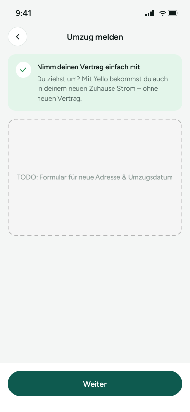

# UM-02 – Umzug melden (WIP)

Screen zum Melden eines Umzugs, damit der bestehende Vertrag in die neue Wohnung mitgenommen werden kann. Er zeigt eine kurze Erklärung und einen Platzhalter für ein noch offenes Formular zur neuen Adresse und zum Umzugsdatum.

> **Datenvertrag:** Abschnitte mit 🤖 hat die KI aus dem Screen abgeleitet. Sie sind ungeprüft.
> Abschnitte mit 📐 kommen direkt aus Figma.

## Letzte Änderung (2026-11-11)

Screen neu angelegt.

## CX · Kundenerlebnis 🤖

**Journey-Moment:** Kundin will einen Umzug melden und den Stromvertrag mitnehmen

**Was die Kundin erlebt:** Die Kundin sieht eine kurze Einleitung, dass sie auch im neuen Zuhause Strom von Yello bekommt. Danach erwartet sie das Formular für die Umzugsdaten.

**Tonalität:** sachlich, freundlich, beruhigend

**Mögliche Reibungspunkte:**
- Das eigentliche Formular ist noch nicht vorhanden, vermutlich ist der Screen unvollständig.
- Unklar, welche Daten genau noch eingegeben werden müssen.
- Der Weiter-Button ist sichtbar, aber ohne Formularwirkung vermutlich noch nicht sinnvoll nutzbar.

## RE · Anforderungen

**Aktionen** 🤖
- Zurück über Pfeil-Icon
- Weiter

**Eingabefelder** 🤖
- keine

**Zustände** 🤖
- Zu sehen: Normaler Screen, WIP/Platzhalter für fehlendes Formular
- Vermutlich noch zu gestalten: Formular für neue Adresse, Eingabe für Umzugsdatum, Validierungsfehler, Disabled-Zustand für Weiter bei fehlenden Angaben

**Navigation** 📐
- Kommt von: –
- Führt zu: –

## BA · Geschäftsregeln 🤖

**Angezeigte Daten:**
- Titel: Umzug melden
- Hinweistext: Nimm deinen Vertrag einfach mit
- Erklärung: Du ziehst um? Mit Yello bekommst du auch in deinem neuen Zuhause Strom – ohne neuen Vertrag.
- Platzhaltertext: TODO: Formular für neue Adresse & Umzugsdatum
- Buttontext: Weiter

**Vermutete Regeln:**
- Vermutlich führt der Screen im Flow zum nächsten Schritt der Umzugsmeldung.
- Vermutlich wird hier die neue Adresse und das Umzugsdatum erfasst.
- Vermutlich ist der Vertrag bestehend und soll ohne Neuvertrag in die neue Adresse übertragen werden.

## QA · Tests

**Testfälle** 🤖
- Screen wird mit Titel, Erklärung und Weiter-Button korrekt dargestellt.
- Zurück-Icon ist sichtbar und bedienbar.
- Platzhalter für Formular ist sichtbar.
- Weiter-Button ist sichtbar.
- Prüfen, ob der Screen auch ohne Formularinhalt stabil dargestellt wird.

**Exakte Texte auf dem Screen** 📐
- 9:41
- Umzug melden
- Nimm deinen Vertrag einfach mit
- Du ziehst um? Mit Yello bekommst du auch in deinem neuen Zuhause Strom – ohne neuen Vertrag.
- TODO: Formular für neue Adresse & Umzugsdatum
- Weiter

## Dev · Umsetzung

**Komponenten aus dem Designsystem** 📐
- Status Bar
- Header/Detail
- Icon Button
- Icon/ChevronLeft
- Icon/Check
- Button

**Datenfelder** 🤖
- Neuer Titel/Screenname
- Hinweistext
- Info-/Intro-Text
- Platzhaltertext für noch fehlendes Formular
- Buttonlabel Weiter

**Hinweise** 🤖
- Designsystem-Komponenten: Status Bar, Header/Detail, Icon Button, Icon/ChevronLeft, Icon/Check, Button
- Der Screen ist als WIP markiert und enthält nur einen Platzhalter statt eines Formulars.
- Keine klickbaren Elemente außer Zurück und Weiter in den Figma-Daten angegeben.

**Dev Mode:** [in Figma öffnen](https://www.figma.com/design/NpRSQ1rdXPvYjjxzDiTjBC?node-id=64-1013&m=dev)

## Analytics · Messung

**Klickbare Elemente (Prototyp)** 📐
- keine Prototyp-Verbindungen in Figma

**Vorgeschlagene Events** 🤖
- klick_zurueck_umzug_melden
- klick_weiter_umzug_melden

**Funnel-Position** 🤖 2 von 2 im Flow 'Umzug – Vertrag mitnehmen'

## PL · Stand

| | |
|---|---|
| **Status** | beschlossen |
| **Flow** | Feature: Umzug – Vertrag mitnehmen (Screen 2 von 2) |
| **Alle Screens im Flow** | UM-01 – Vertrag mit Umzug-Einstieg → UM-02 – Umzug melden (WIP) |
| **Zuletzt geändert** | 2026-11-11 |
| **Figma** | [Screen öffnen](https://www.figma.com/design/NpRSQ1rdXPvYjjxzDiTjBC?node-id=64-1013) |

**Offene Fragen** 🤖
- Welche Felder gehören ins Formular für neue Adresse und Umzugsdatum?
- Welche Validierung ist für die Eingaben vorgesehen?
- Wohin führt der Weiter-Button genau?
- Ist der Weiter-Button ohne Eingaben aktiv oder deaktiviert?
