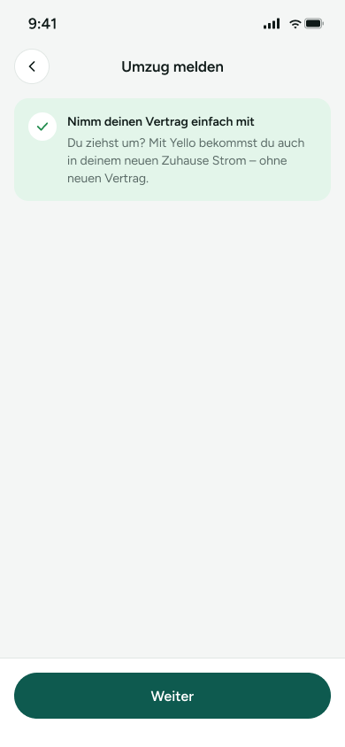

# UM-02 – Umzug melden

Screen im Umzugs-Flow, der erklärt, dass der bestehende Vertrag beim Umzug mitgenommen werden kann. Er dient als kurzer Einstieg vor dem nächsten Schritt im Flow.

> **Datenvertrag:** Abschnitte mit 🤖 hat die KI aus dem Screen abgeleitet. Sie sind ungeprüft.
> Abschnitte mit 📐 kommen direkt aus Figma.

## Letzte Änderung (2026-11-11)

Der frühere Platzhalter für ein Formular („TODO: Formular für neue Adresse & Umzugsdatum“) ist entfernt. Der Screen zeigt jetzt nur noch die Erklärungskarte mit Icon sowie den Button „Weiter“.

## CX · Kundenerlebnis 🤖

**Journey-Moment:** Kundin informiert sich im Umzugsprozess, bevor sie die neue Adresse eingibt.

**Was die Kundin erlebt:** Die Kundin bekommt eine kurze, positive Erklärung, dass der Vertrag bei einem Umzug weitergeführt werden kann.

**Tonalität:** sachlich, beruhigend, unterstützend

**Mögliche Reibungspunkte:**
- vermutlich unklar, was nach „Weiter“ konkret passiert
- vermutlich fehlt auf diesem Screen noch die Eingabe der Umzugsdaten
- vermutlich kann die sehr reduzierte Seite ohne weitere Hinweise Orientierung vermissen lassen

## RE · Anforderungen

**Aktionen** 🤖
- Zurück über den Pfeil links oben
- Weiter

**Eingabefelder** 🤖
- keine

**Zustände** 🤖
- Zu sehen: Normalzustand
- Vermutlich noch zu gestalten: vermutlich Ladezustand, vermutlich Fehlerzustand, vermutlich deaktivierter Weiter-Button

**Navigation** 📐
- Kommt von: –
- Führt zu: –

## BA · Geschäftsregeln 🤖

**Angezeigte Daten:**
- Schritttitel: „Umzug melden“
- Headline: „Nimm deinen Vertrag einfach mit“
- Erklärungstext zum Mitnehmen des Vertrags in die neue Wohnung
- Flow-Position: 2 von 3

**Vermutete Regeln:**
- vermutlich ist dies ein Zwischenschritt im Umzugs-Flow
- vermutlich führt „Weiter“ zum nächsten Schritt mit weiteren Umzugsdaten

## QA · Tests

**Testfälle** 🤖
- Seite wird mit Titel, Hinweisbox und Button korrekt angezeigt
- Zurück-Icon führt zum vorherigen Screen
- Weiter-Button ist sichtbar und anklickbar
- Textumbrüche und Layout funktionieren auf kleiner Bildschirmbreite

**Exakte Texte auf dem Screen** 📐
- 9:41
- Umzug melden
- Nimm deinen Vertrag einfach mit
- Du ziehst um? Mit Yello bekommst du auch in deinem neuen Zuhause Strom – ohne neuen Vertrag.
- Weiter

## Dev · Umsetzung

**Komponenten aus dem Designsystem** 📐
- Status Bar
- Header/Detail
- Icon Button
- Icon/ChevronLeft
- Icon/Check
- Button

**Datenfelder** 🤖
- Screen-Titel
- Headline
- Erklärungstext
- Flow-Schritt/Progress-Info

**Hinweise** 🤖
- Designsystem-Komponenten: Status Bar, Header/Detail, Icon Button, Icon/ChevronLeft, Icon/Check, Button
- keine Eingabefelder auf diesem Screen sichtbar
- Weiter-Button am unteren Bildschirmrand platziert

**Dev Mode:** [in Figma öffnen](https://www.figma.com/design/NpRSQ1rdXPvYjjxzDiTjBC?node-id=64-1013&m=dev)

## Analytics · Messung

**Klickbare Elemente (Prototyp)** 📐
- keine Prototyp-Verbindungen in Figma

**Vorgeschlagene Events** 🤖
- klick_zurueck_umzug_melden
- klick_weiter_umzug_melden

**Funnel-Position** 🤖 2 von 3 im Umzug-Flow „Vertrag mitnehmen"

## PL · Stand

| | |
|---|---|
| **Status** | beschlossen |
| **Flow** | Feature: Umzug – Vertrag mitnehmen (Screen 2 von 3) |
| **Alle Screens im Flow** | UM-01 – Vertrag mit Umzug-Einstieg → UM-02 – Umzug melden → UM-03 – Neue Adresse |
| **Zuletzt geändert** | 2026-11-11 |
| **Figma** | [Screen öffnen](https://www.figma.com/design/NpRSQ1rdXPvYjjxzDiTjBC?node-id=64-1013) |

**Offene Fragen** 🤖
- Wohin führt „Weiter“ genau?
- Soll auf diesem Screen bereits ein Fortschritt oder eine Schrittanzeige sichtbar sein?
- Warum ist das Formular für neue Adresse und Umzugsdatum entfernt worden bzw. kommt es im nächsten Screen?
