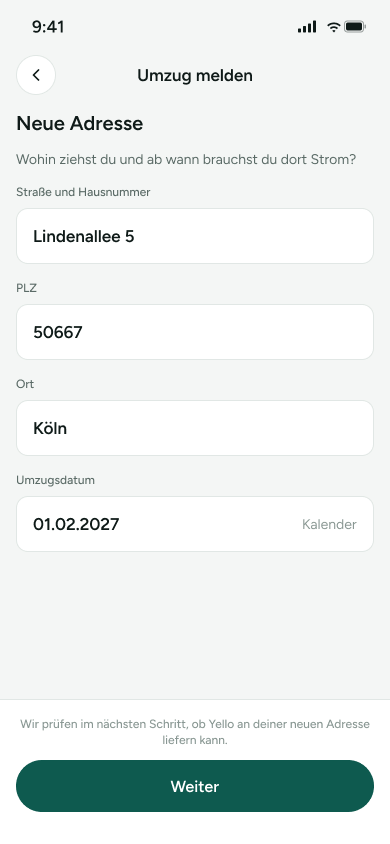

# UM-03 – Neue Adresse

Screen zum Erfassen der neuen Adresse und des Umzugsdatums im Flow „Umzug – Vertrag mitnehmen“. Die Nutzerin kann die Zieladresse prüfen/ändern und anschließend mit „Weiter“ fortfahren.

> **Datenvertrag:** Abschnitte mit 🤖 hat die KI aus dem Screen abgeleitet. Sie sind ungeprüft.
> Abschnitte mit 📐 kommen direkt aus Figma.

## Letzte Änderung (2026-11-11)

Screen neu angelegt.

## CX · Kundenerlebnis 🤖

**Journey-Moment:** Kundin gibt die neue Adresse im Umzugsprozess an.

**Was die Kundin erlebt:** Die Kundin sieht ein Formular mit bereits eingetragenen Adressdaten und einem Umzugsdatum. Unten wird erklärt, dass im nächsten Schritt geprüft wird, ob Yello an der neuen Adresse liefern kann.

**Tonalität:** sachlich, ruhig, informierend

**Mögliche Reibungspunkte:**
- vermutlich ist unklar, ob die Felder schon validiert sind oder noch bearbeitet werden müssen
- vermutlich ist nicht sichtbar, was passiert, wenn Yello an der neuen Adresse nicht liefern kann
- vermutlich ist nicht ersichtlich, ob das Umzugsdatum über den Kalender zwingend auswählbar ist

## RE · Anforderungen

**Aktionen** 🤖
- Adresseingaben prüfen oder ändern
- Umzugsdatum erfassen oder ändern
- Mit „Weiter“ fortfahren
- Mit dem Zurück-Pfeil zum vorherigen Screen gehen

**Eingabefelder** 🤖
- Straße und Hausnummer: Texteingabe
- PLZ: Texteingabe
- Ort: Texteingabe
- Umzugsdatum: Datumsauswahl

**Zustände** 🤖
- Zu sehen: Normalzustand mit vorausgefüllten Feldern
- Vermutlich noch zu gestalten: Fehlerzustand bei ungültiger PLZ, Fehlerzustand bei ungültigem Datum, Leerer Zustand ohne vorausgefüllte Werte, Ladezustand für Adress-/Verfügbarkeitsprüfung

**Navigation** 📐
- Kommt von: –
- Führt zu: –

## BA · Geschäftsregeln 🤖

**Angezeigte Daten:**
- Straße und Hausnummer: Lindenallee 5
- PLZ: 50667
- Ort: Köln
- Umzugsdatum: 01.02.2027
- Hinweis: „Wir prüfen im nächsten Schritt, ob Yello an deiner neuen Adresse liefern kann.“

**Vermutete Regeln:**
- vermutlich wird im nächsten Schritt die Lieferbarkeit an der neuen Adresse geprüft
- vermutlich muss das Umzugsdatum in einem gültigen Format bzw. als auswählbares Datum vorliegen
- vermutlich sind Straße, PLZ, Ort und Umzugsdatum Pflichtfelder

## QA · Tests

**Testfälle** 🤖
- Seite wird mit allen vorausgefüllten Werten korrekt angezeigt
- Zurück-Pfeil führt zum vorherigen Screen
- „Weiter“ ist sichtbar und anklickbar
- Datum kann über den Kalender geöffnet/geändert werden
- Pflichtfelder reagieren bei leerem oder ungültigem Inhalt mit Fehlerzustand
- Hinweistext wird vollständig angezeigt

**Exakte Texte auf dem Screen** 📐
- 9:41
- Umzug melden
- Neue Adresse
- Wohin ziehst du und ab wann brauchst du dort Strom?
- Straße und Hausnummer
- Lindenallee 5
- PLZ
- 50667
- Ort
- Köln
- Umzugsdatum
- 01.02.2027
- Kalender
- Wir prüfen im nächsten Schritt, ob Yello an deiner neuen Adresse liefern kann.
- Weiter

## Dev · Umsetzung

**Komponenten aus dem Designsystem** 📐
- Status Bar
- Header/Detail
- Icon Button
- Icon/ChevronLeft
- Input Field
- Button

**Datenfelder** 🤖
- street
- house_number
- postal_code
- city
- move_in_date

**Hinweise** 🤖
- Input Fields und Button aus dem Designsystem verwenden
- Kalender-Interaktion für das Datumsfeld vorsehen
- Header mit Titel und Zurück-Icon umsetzen
- Hinweistext unterhalb der Form und oberhalb des Primärbuttons platzieren

**Dev Mode:** [in Figma öffnen](https://www.figma.com/design/NpRSQ1rdXPvYjjxzDiTjBC?node-id=68-977&m=dev)

## Analytics · Messung

**Klickbare Elemente (Prototyp)** 📐
- keine Prototyp-Verbindungen in Figma

**Vorgeschlagene Events** 🤖
- klick_zurueck_umzug_neue_adresse
- klick_kalender_umzugsdatum
- klick_weiter_umzug_neue_adresse

**Funnel-Position** 🤖 Schritt 3 von 3 im Flow „Umzug – Vertrag mitnehmen“

## PL · Stand

| | |
|---|---|
| **Status** | beschlossen |
| **Flow** | Feature: Umzug – Vertrag mitnehmen (Screen 3 von 3) |
| **Alle Screens im Flow** | UM-01 – Vertrag mit Umzug-Einstieg → UM-02 – Umzug melden → UM-03 – Neue Adresse |
| **Zuletzt geändert** | 2026-11-11 |
| **Figma** | [Screen öffnen](https://www.figma.com/design/NpRSQ1rdXPvYjjxzDiTjBC?node-id=68-977) |

**Offene Fragen** 🤖
- Ist die Bearbeitung der vorausgefüllten Adresse erlaubt oder sind die Werte nur angezeigt?
- Was passiert, wenn Yello an der neuen Adresse nicht liefern kann?
- Welche Validierungen gelten für PLZ, Ort und Umzugsdatum?
- Öffnet der Text „Kalender“ direkt einen Datepicker oder ist es nur eine Feldbeschriftung?
