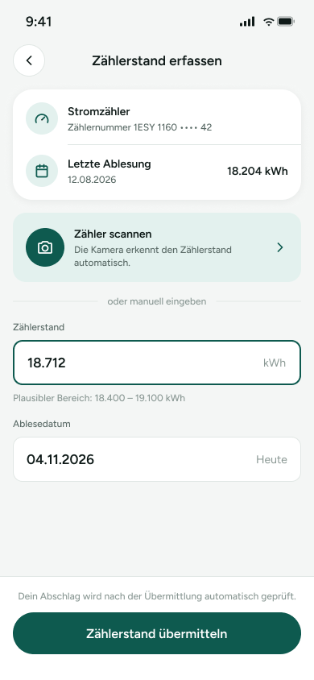

# ZS-01 – Zählerstand erfassen

Screen zum Erfassen und Übermitteln eines Strom-Zählerstands. Die Nutzerin kann den Zählerstand offenbar scannen oder manuell eingeben und anschließend übermitteln.

> **Datenvertrag:** Abschnitte mit 🤖 hat die KI aus dem Screen abgeleitet. Sie sind ungeprüft.
> Abschnitte mit 📐 kommen direkt aus Figma.

## Letzte Änderung (2026-11-11)

Screen neu angelegt.

## CX · Kundenerlebnis 🤖

**Journey-Moment:** Kundin erfasst einen aktuellen Zählerstand zur Meldung an den Anbieter

**Was die Kundin erlebt:** Sie sieht die relevanten Zählerdetails, kann einen Wert erfassen und den Ablesetag angeben. Der Hinweis zum Abschlag signalisiert eine mögliche Folge nach der Übermittlung.

**Tonalität:** sachlich, unterstützend, eher beruhigend

**Mögliche Reibungspunkte:**
- Der Hinweis zum plausiblen Bereich könnte Unsicherheit auslösen, wenn der eingegebene Wert davon abweicht.
- Die Rolle des Buttons „Zähler scannen“ ist vermutlich klar, aber es ist nicht sichtbar, was nach dem Antippen passiert.
- Es ist nicht ersichtlich, ob das Ablesedatum editierbar ist oder automatisch gesetzt wird.

## RE · Anforderungen

**Aktionen** 🤖
- Zähler scannen
- Zählerstand manuell eingeben
- Ablesedatum auswählen
- Zählerstand übermitteln

**Eingabefelder** 🤖
- Zählerstand: numerische Eingabe
- Ablesedatum: Datumsauswahl

**Zustände** 🤖
- Zu sehen: Normalzustand, Hinweis auf plausiblen Bereich
- Vermutlich noch zu gestalten: Ladezustand, Fehlerzustand bei ungültigem Zählerstand, Validierungszustand bei außerhalb des plausiblen Bereichs, Erfolgs- oder Bestätigungszustand nach Übermittlung

**Navigation** 📐
- Kommt von: –
- Führt zu: –

## BA · Geschäftsregeln 🤖

**Angezeigte Daten:**
- Zählerart: Stromzähler
- Zählernummer: 1ESY 1160 •••• 42
- Letzte Ablesung: 12.08.2026
- Letzter Zählerstand: 18.204 kWh
- Aktueller Zählerstand: 18.712 kWh
- Plausibler Bereich: 18.400 – 19.100 kWh
- Ablesedatum: 04.11.2026

**Vermutete Regeln:**
- Der eingegebene Zählerstand wird vermutlich gegen einen plausiblen Bereich geprüft.
- Die Übermittlung prüft den Abschlag vermutlich automatisch nach dem Absenden.
- Das Ablesedatum ist vermutlich auf „Heute“ beziehbar bzw. wird auf das aktuelle Datum gesetzt oder vorgeschlagen.

## QA · Tests

**Testfälle** 🤖
- Zählerstand manuell mit Dezimal-/Tausenderformat prüfen
- Zählerstand innerhalb des plausiblen Bereichs eingeben und übermitteln
- Zählerstand außerhalb des plausiblen Bereichs eingeben und erwartete Reaktion prüfen
- Ablesedatum öffnen und ein Datum auswählen
- Zähler scannen antippen und Navigation/Verhalten prüfen
- Übermitteln mit den sichtbaren Standardwerten auslösen

**Exakte Texte auf dem Screen** 📐
- 9:41
- Zählerstand erfassen
- Stromzähler
- Zählernummer 1ESY 1160 •••• 42
- Letzte Ablesung
- 12.08.2026
- 18.204 kWh
- Zähler scannen
- Die Kamera erkennt den Zählerstand automatisch.
- oder manuell eingeben
- Zählerstand
- 18.712
- kWh
- Plausibler Bereich: 18.400 – 19.100 kWh
- Ablesedatum
- 04.11.2026
- Heute
- Dein Abschlag wird nach der Übermittlung automatisch geprüft.
- Zählerstand übermitteln

## Dev · Umsetzung

**Komponenten aus dem Designsystem** 📐
- Status Bar
- Header/Detail
- Icon Button
- Icon/ChevronLeft
- List Row
- Icon/Meter
- Icon/Calendar
- Icon/Camera
- Icon/ChevronRight
- Input Field
- Button

**Datenfelder** 🤖
- zählerart
- zählernummer
- letzte_ablesung_datum
- letzter_zaehlerstand
- aktueller_zaehlerstand
- einheit
- plausibler_bereich_min
- plausibler_bereich_max
- ablesedatum

**Hinweise** 🤖
- Zählernummer ist maskiert dargestellt.
- Die Kamera-Funktion ist als eigener Einstieg vorhanden; das Zielverhalten ist aus dem Screen allein nicht ersichtlich.
- Datum und Werte müssen im UI formatiert dargestellt werden.
- Der Button „Zählerstand übermitteln“ ist als primäre Aktion zu behandeln.

**Dev Mode:** [in Figma öffnen](https://www.figma.com/design/NpRSQ1rdXPvYjjxzDiTjBC?node-id=64-1080&m=dev)

## Analytics · Messung

**Klickbare Elemente (Prototyp)** 📐
- keine Prototyp-Verbindungen in Figma

**Vorgeschlagene Events** 🤖
- klick_zaehler_scannen
- klick_zaehlerstand_feld
- klick_ablesedatum_feld
- klick_zaehlerstand_uebermitteln

**Funnel-Position** 🤖 Start- und einziges Formular-Element im Flow „Zählerstand abgeben“

## PL · Stand

| | |
|---|---|
| **Status** | beschlossen |
| **Flow** | Feature: Zählerstand abgeben (Screen 1 von 1) |
| **Alle Screens im Flow** | ZS-01 – Zählerstand erfassen |
| **Zuletzt geändert** | 2026-11-11 |
| **Figma** | [Screen öffnen](https://www.figma.com/design/NpRSQ1rdXPvYjjxzDiTjBC?node-id=64-1080) |

**Offene Fragen** 🤖
- Was passiert nach „Zähler scannen“ konkret?
- Ist das Ablesedatum frei wählbar oder nur vorgegeben?
- Welche Validierung gilt genau für den Zählerstand?
- Ist die Übermittlung nur bei gültigen Eingaben möglich?
- Gibt es eine Bestätigung oder einen Erfolgszustand nach dem Absenden?
