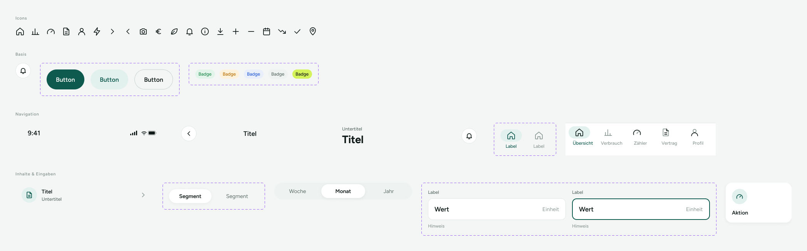

# Komponenten-Bibliothek

Übersicht über die UI-Komponenten einer Komponenten-Bibliothek bzw. eines Designsystems. Der Screen zeigt Beispiele für Icons, Buttons, Badges, Navigation, Segmented Controls, Eingabefelder und Quick Actions.

> **Datenvertrag:** Abschnitte mit 🤖 hat die KI aus dem Screen abgeleitet. Sie sind ungeprüft.
> Abschnitte mit 📐 kommen direkt aus Figma.

## Letzte Änderung (2026-11-04)

Screen neu angelegt.

## CX · Kundenerlebnis 🤖

**Journey-Moment:** vermutlich interne Design-/Entwicklungsphase, kein Kund:innen-Journey-Moment

**Was die Kundin erlebt:** Keine direkte Kund:innen-Interaktion erkennbar; der Screen dient vermutlich zur Abstimmung und Nutzung von UI-Komponenten.

**Tonalität:** neutral, sachlich, beispielhaft

**Mögliche Reibungspunkte:**
- vermutlich ohne erklärenden Kontext schwer verständlich, wofür die Komponenten im Produkt genutzt werden
- vermutlich sind mehrere Zustände derselben Komponente dargestellt, ohne Beschriftung der Unterschiede

## RE · Anforderungen

**Aktionen** 🤖
- keine sichtbaren Nutzeraktionen
- vermutlich Komponenten ansehen und für andere Screens referenzieren

**Eingabefelder** 🤖
- keine

**Zustände** 🤖
- Zu sehen: Normalzustand bei Buttons, Badges und Navigation, vermutlich Fokus-/Aktivzustand bei ausgewählten Navigationselementen, vermutlich deaktivierte bzw. inaktive Zustände bei einzelnen Tab-Elementen
- Vermutlich noch zu gestalten: Fehlerzustand für Eingabefelder, Ladezustand, Disabled-Zustände für weitere Komponenten, Leerzustände

**Navigation** 📐
- Kommt von: –
- Führt zu: –

## BA · Geschäftsregeln 🤖

**Angezeigte Daten:**
- Icons aus dem Designsystem
- Buttons in drei Varianten
- Badges in mehreren Farbvarianten
- Navigation mit Übersicht, Verbrauch, Zähler, Vertrag, Profil
- Segmented Control mit Woche, Monat, Jahr
- Eingabefeld mit Label, Wert, Einheit und Hinweis
- Quick Action mit Icon und Bezeichnung Aktion

**Vermutete Regeln:**
- vermutlich werden hier Standardzustände und Varianten von Designsystem-Komponenten dokumentiert
- vermutlich ist die Tab Bar für die Hauptnavigation gedacht
- vermutlich markieren Icon/Farbe/Text unterschiedliche Status oder Kategorien

## QA · Tests

**Testfälle** 🤖
- Prüfen, ob alle sichtbaren Komponenten korrekt gerendert werden
- Prüfen, ob die Icons dem Figma-Set entsprechen
- Prüfen, ob aktive und inaktive Zustände visuell unterscheidbar sind
- Prüfen, ob Button-, Badge- und Tab-Varianten konsistent dargestellt werden
- Prüfen, ob Eingabefeld-Elemente Label, Wert, Einheit und Hinweis korrekt anzeigen
- Prüfen, ob keine klickbaren Elemente fälschlich Navigation auslösen

**Exakte Texte auf dem Screen** 📐
- Icons
- Basis
- Button
- Badge
- Navigation
- 9:41
- Titel
- Untertitel
- Label
- Übersicht
- Verbrauch
- Zähler
- Vertrag
- Profil
- Inhalte & Eingaben
- Segment
- Woche
- Monat
- Jahr
- Wert
- Einheit
- Hinweis
- Aktion

## Dev · Umsetzung

**Komponenten aus dem Designsystem** 📐
- Icon/Home
- Icon/Chart
- Icon/Meter
- Icon/Document
- Icon/User
- Icon/Bolt
- Icon/ChevronRight
- Icon/ChevronLeft
- Icon/Camera
- Icon/Euro
- Icon/Leaf
- Icon/Bell
- Icon/Info
- Icon/Download
- Icon/Plus
- Icon/Minus
- Icon/Calendar
- Icon/TrendDown
- Icon/Check
- Icon/MapPin
- Icon Button
- Status Bar
- Header/Detail
- Header/Main
- Tab Bar
- Tab Item
- List Row
- Segmented Control
- Segment
- Quick Action

**Datenfelder** 🤖
- Komponentenname
- Variante/Zustand
- Icon-Name
- Label-Text
- Titel-Text
- Untertitel-Text
- Wert-Text
- Einheit-Text
- Hinweis-Text
- Tab-Name

**Hinweise** 🤖
- Screen wirkt wie eine statische Bibliotheks-/Referenzansicht
- Komponenten sollten als wiederverwendbare UI-Bausteine umgesetzt werden
- Mehrere Zustände derselben Komponente sollten als Varianten modelliert werden

**Dev Mode:** [in Figma öffnen](https://www.figma.com/design/NpRSQ1rdXPvYjjxzDiTjBC?node-id=20-1260&m=dev)

## Analytics · Messung

**Klickbare Elemente (Prototyp)** 📐
- keine Prototyp-Verbindungen in Figma

**Vorgeschlagene Events** 🤖
- –

**Funnel-Position** 🤖 vermutlich kein Produkt-Funnel, sondern interne Foundations-/Komponenten-Ansicht

## PL · Stand

| | |
|---|---|
| **Status** | beschlossen |
| **Flow** | Foundations & Komponenten (Screen 1 von 1) |
| **Alle Screens im Flow** | Komponenten-Bibliothek |
| **Zuletzt geändert** | 2026-11-04 |
| **Figma** | [Screen öffnen](https://www.figma.com/design/NpRSQ1rdXPvYjjxzDiTjBC?node-id=20-1260) |

**Offene Fragen** 🤖
- Ist der Screen nur für interne Nutzung oder auch für produktive App-Inhalte gedacht?
- Sollen die Komponenten auf dem Screen interaktiv sein oder nur dokumentiert werden?
- Welche Zustände gelten für die einzelnen Komponenten genau?
- Welche Bedeutung haben die unterschiedlichen Badge-Farben?
- Sind die sichtbaren Labels und Texte nur Platzhalter oder final?
