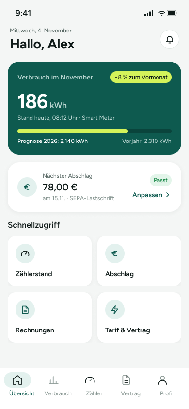

# 01 – Übersicht

Start-/Übersichtsseite der Strom-App mit aktuellem Verbrauch, nächstem Abschlag und Schnellzugriffen auf wichtige Bereiche. Unten ist eine Tab-Bar für die Hauptnavigation sichtbar.

> **Datenvertrag:** Abschnitte mit 🤖 hat die KI aus dem Screen abgeleitet. Sie sind ungeprüft.
> Abschnitte mit 📐 kommen direkt aus Figma.

## Letzte Änderung (2026-11-04)

Screen neu angelegt.

## CX · Kundenerlebnis 🤖

**Journey-Moment:** Einstieg nach dem App-Start bzw. nach dem Login

**Was die Kundin erlebt:** Die Kundin sieht auf einen Blick den aktuellen Verbrauch, eine Prognose und den nächsten Abschlag. Zusätzlich gibt es direkte Einstiege zu häufig genutzten Funktionen.

**Tonalität:** sachlich, informativ, übersichtlich

**Mögliche Reibungspunkte:**
- Die Bedeutung von "Passt" und "Anpassen" ist ohne Kontext eventuell nicht sofort klar.
- "Prognose 2026" könnte erklärungsbedürftig sein, weil unklar ist, wie sie berechnet wird.
- "Smart Meter" setzt vermutlich voraus, dass die Kundin mit dem Begriff etwas anfangen kann.

## RE · Anforderungen

**Aktionen** 🤖
- Benachrichtigungen über das Glocken-Icon öffnen
- Über "Anpassen" den Abschlag bearbeiten
- Über die Schnellzugriffe zu Zählerstand, Abschlag, Rechnungen oder Tarif & Vertrag springen
- Über die Tab-Bar zu Übersicht, Verbrauch, Zähler, Vertrag oder Profil wechseln

**Eingabefelder** 🤖
- keine

**Zustände** 🤖
- Zu sehen: Normalzustand, aktive Tab-Bar auf "Übersicht", Badge am Benachrichtigungs-Icon
- Vermutlich noch zu gestalten: Ladezustand, Fehlerzustand für Verbrauchsdaten, Leerzustand für keine Verbrauchs- oder Abschlagsdaten, Bearbeitungs-/Bestätigungszustand für "Anpassen"

**Navigation** 📐
- Kommt von: –
- Führt zu: –

## BA · Geschäftsregeln 🤖

**Angezeigte Daten:**
- Aktuelles Datum: Mittwoch, 4. November
- Begrüßung: Hallo, Alex
- Verbrauch im November: 186 kWh
- Vergleich zum Vormonat: −8 %
- Stand heute, 08:12 Uhr · Smart Meter
- Prognose 2026: 2.140 kWh
- Vorjahr: 2.310 kWh
- Nächster Abschlag: 78,00 €
- Fälligkeit: am 15.11.
- Zahlungsart: SEPA-Lastschrift

**Vermutete Regeln:**
- Der Verbrauch wird als Monatswert mit Vergleich zum Vormonat dargestellt.
- Die Prognose und der Vorjahreswert beziehen sich vermutlich auf den Jahresverbrauch.
- Wenn ein nächster Abschlag vorhanden ist, wird ein Status wie "Passt" angezeigt und eine Anpassung angeboten.

## QA · Tests

**Testfälle** 🤖
- Übersicht lädt mit allen sichtbaren Kennzahlen und Texten.
- Badge am Benachrichtigungs-Icon wird korrekt angezeigt.
- Aktiver Tab "Übersicht" ist optisch hervorgehoben.
- Schnellzugriff-Kacheln sind sichtbar und getrennt anklickbar.
- Anzeige von Verbrauch, Vergleichswert, Prognose und Vorjahreswert ist vollständig.
- Anzeige des nächsten Abschlags inkl. Betrag, Datum und Zahlungsart ist vollständig.

**Exakte Texte auf dem Screen** 📐
- 9:41
- Mittwoch, 4. November
- Hallo, Alex
- Verbrauch im November
- −8 % zum Vormonat
- 186
- kWh
- Stand heute, 08:12 Uhr · Smart Meter
- Prognose 2026: 2.140 kWh
- Vorjahr: 2.310 kWh
- Nächster Abschlag
- 78,00 €
- am 15.11. · SEPA-Lastschrift
- Passt
- Anpassen
- Schnellzugriff
- Zählerstand
- Abschlag
- Rechnungen
- Tarif & Vertrag
- Übersicht
- Verbrauch
- Zähler
- Vertrag
- Profil

## Dev · Umsetzung

**Komponenten aus dem Designsystem** 📐
- Status Bar
- Header/Main
- Icon Button
- Icon/Bell
- Badge
- Icon/Euro
- Icon/ChevronRight
- Quick Action
- Icon/Meter
- Icon/Document
- Icon/Bolt
- Tab Bar
- Tab Item
- Icon/Home
- Icon/Chart
- Icon/User

**Datenfelder** 🤖
- currentDate
- userName
- monthlyConsumptionKwh
- comparisonToPreviousMonthPercent
- measurementTimestamp
- meterType
- annualForecastKwh
- previousYearKwh
- nextInstallmentAmount
- nextInstallmentDueDate
- paymentMethod
- notificationBadgeCount

**Hinweise** 🤖
- Komponenten aus dem Designsystem verwenden: Status Bar, Header/Main, Quick Action, Tab Bar.
- Währung und kWh-Einheiten müssen korrekt formatiert werden.
- Die Schnellzugriffe und die Tab-Bar sollten klare Navigationsziele haben, auch wenn im Figma-Export keine Ziele hinterlegt sind.
- Das Badge am Glocken-Icon benötigt eine Quelle für ungelesene Benachrichtigungen.

**Dev Mode:** [in Figma öffnen](https://www.figma.com/design/NpRSQ1rdXPvYjjxzDiTjBC?node-id=20-1350&m=dev)

## Analytics · Messung

**Klickbare Elemente (Prototyp)** 📐
- keine Prototyp-Verbindungen in Figma

**Vorgeschlagene Events** 🤖
- view_uebersicht
- click_benachrichtigung
- click_anpassen_abschlag
- click_quick_action_zaehlerstand
- click_quick_action_abschlag
- click_quick_action_rechnungen
- click_quick_action_tarif_vertrag
- click_tab_uebersicht
- click_tab_verbrauch
- click_tab_zaehler
- click_tab_vertrag
- click_tab_profil

**Funnel-Position** 🤖 Startscreen / Hauptnavigation nach dem Einstieg in die App

## PL · Stand

| | |
|---|---|
| **Status** | beschlossen |
| **Flow** | Screens – Strom-App (Screen 1 von 5) |
| **Alle Screens im Flow** | 01 – Übersicht → 02 – Verbrauch → 03 – Zählerstand erfassen → 04 – Abschlag anpassen → 05 – Vertrag |
| **Zuletzt geändert** | 2026-11-04 |
| **Figma** | [Screen öffnen](https://www.figma.com/design/NpRSQ1rdXPvYjjxzDiTjBC?node-id=20-1350) |

**Offene Fragen** 🤖
- Wofür steht "Passt" fachlich genau?
- Welche Zielseiten öffnen die Schnellzugriffe und die Tab-Bar konkret?
- Ist "Prognose 2026" der Jahresverbrauch oder ein anderer Zeitraum?
- Ist das Badge am Glocken-Icon immer sichtbar oder abhängig von neuen Nachrichten?
