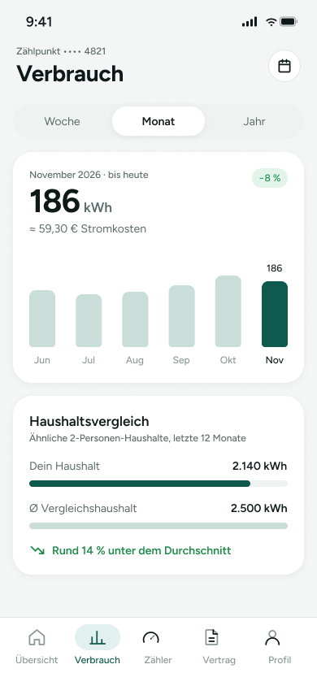

# 02 – Verbrauch

Übersichtsseite zum Stromverbrauch mit Zeitfilter (Woche/Monat/Jahr), Kennzahl für den aktuellen Zeitraum und Haushaltsvergleich. Unten ist die Tab-Navigation sichtbar, der Bereich „Verbrauch“ ist aktiv.

> **Datenvertrag:** Abschnitte mit 🤖 hat die KI aus dem Screen abgeleitet. Sie sind ungeprüft.
> Abschnitte mit 📐 kommen direkt aus Figma.

## Letzte Änderung (2026-11-04)

Screen neu angelegt.

## CX · Kundenerlebnis 🤖

**Journey-Moment:** Kundin schaut ihren aktuellen Stromverbrauch und den Vergleich zum Durchschnitt an

**Was die Kundin erlebt:** Die Nutzerin sieht ihren Verbrauch für einen gewählten Zeitraum und kann den Verlauf grob über Monate einordnen. Zusätzlich bekommt sie eine Einordnung im Haushaltsvergleich.

**Tonalität:** sachlich, informativ, leicht unterstützend

**Mögliche Reibungspunkte:**
- Die Bedeutung von „bis heute“ ist aus dem Screen allein nicht ganz klar, vermutlich wird der laufende Monat anteilig angezeigt.
- Die Kennzahl „−8 %“ ist ohne Vergleichsbasis nicht vollständig erklärbar, vermutlich bezieht sie sich auf eine Veränderung zum vorherigen Zeitraum.
- Der Haushaltsvergleich nennt „ähnliche 2-Personen-Haushalte“, aber Kriterien für „ähnlich“ sind nicht sichtbar.

## RE · Anforderungen

**Aktionen** 🤖
- Zeitraum über Segmented Control wechseln: Woche, Monat, Jahr
- vermutlich im Diagramm einen Monat auswählen oder ablesen
- über Tab Bar zu Übersicht, Zähler, Vertrag oder Profil wechseln

**Eingabefelder** 🤖
- keine

**Zustände** 🤖
- Zu sehen: Normalzustand, Monatsansicht aktiv, Badge/Highlight für aktuelle Veränderung, Vergleichskarte mit Balkenanzeige
- Vermutlich noch zu gestalten: Ladezustand, Fehlerzustand bei fehlenden Verbrauchsdaten, Leerzustand ohne Vergleichsdaten, Detailzustand für ausgewählte Diagrammpunkte

**Navigation** 📐
- Kommt von: –
- Führt zu: –

## BA · Geschäftsregeln 🤖

**Angezeigte Daten:**
- Zählpunkt: •••• 4821
- Zeitraum: November 2026 · bis heute
- Verbrauch: 186 kWh
- Stromkosten: ≈ 59,30 €
- Veränderung: −8 %
- Monate im Diagramm: Jun, Jul, Aug, Sep, Okt, Nov
- Haushaltsvergleich: Ähnliche 2-Personen-Haushalte, letzte 12 Monate
- Dein Haushalt: 2.140 kWh
- Ø Vergleichshaushalt: 2.500 kWh
- Einordnung: Rund 14 % unter dem Durchschnitt

**Vermutete Regeln:**
- Der Zählpunkt wird teilweise maskiert angezeigt.
- Der aktive Zeitraum steuert die Kennzahlen und das Diagramm.
- Die Kosten sind vermutlich aus dem Verbrauch berechnet.
- Der Vergleich bezieht sich vermutlich auf die letzten 12 Monate.
- Die Prozentangabe unter dem Diagramm und die Vergleichseinordnung sind vermutlich automatisch aus den Verbrauchsdaten abgeleitet.

## QA · Tests

**Testfälle** 🤖
- Prüfen, ob der Screen im Zustand „Monat“ startet und der Tab „Verbrauch“ aktiv markiert ist.
- Prüfen, ob bei Auswahl von Woche/Monat/Jahr die sichtbaren Inhalte wechseln.
- Prüfen, ob der Zählpunkt maskiert dargestellt wird.
- Prüfen, ob Verbrauch, Kosten und Prozentbadge korrekt angezeigt werden.
- Prüfen, ob das Diagramm die Monate Jun bis Nov in korrekter Reihenfolge zeigt.
- Prüfen, ob der Haushaltsvergleich mit beiden Balken und der Textzeile dargestellt wird.
- Prüfen, ob die Bottom-Navigation alle fünf Tabs zeigt und der aktive Tab visuell hervorgehoben ist.

**Exakte Texte auf dem Screen** 📐
- 9:41
- Zählpunkt •••• 4821
- Verbrauch
- Woche
- Monat
- Jahr
- November 2026 · bis heute
- 186
- kWh
- ≈ 59,30 € Stromkosten
- −8 %
- Jun
- Jul
- Aug
- Sep
- Okt
- Nov
- Haushaltsvergleich
- Ähnliche 2-Personen-Haushalte, letzte 12 Monate
- Dein Haushalt
- 2.140 kWh
- Ø Vergleichshaushalt
- 2.500 kWh
- Rund 14 % unter dem Durchschnitt
- Übersicht
- Zähler
- Vertrag
- Profil

## Dev · Umsetzung

**Komponenten aus dem Designsystem** 📐
- Status Bar
- Header/Main
- Icon Button
- Icon/Calendar
- Segmented Control
- Segment
- Badge
- Icon/TrendDown
- Tab Bar
- Tab Item
- Icon/Home
- Icon/Chart
- Icon/Meter
- Icon/Document
- Icon/User

**Datenfelder** 🤖
- masked_meter_point_id / Zählpunktanzeige
- selected_time_range
- period_label
- consumption_kwh
- estimated_cost_eur
- change_percent
- chart_labels
- chart_values
- comparison_title
- comparison_subtitle
- household_consumption_kwh
- comparison_household_kwh
- comparison_percent_text
- active_bottom_tab

**Hinweise** 🤖
- Segmented Control und Tab Bar stammen aus dem Designsystem.
- Diagramm und Vergleichskarte benötigen strukturierte Daten für Labels und Werte.
- Der aktive Monat im Diagramm ist visuell hervorgehoben.
- Für die Kostenanzeige wird ein geschätzter oder berechneter Wert benötigt, die Berechnungslogik ist im Screen nicht sichtbar.

**Dev Mode:** [in Figma öffnen](https://www.figma.com/design/NpRSQ1rdXPvYjjxzDiTjBC?node-id=20-1390&m=dev)

## Analytics · Messung

**Klickbare Elemente (Prototyp)** 📐
- keine Prototyp-Verbindungen in Figma

**Vorgeschlagene Events** 🤖
- klick_zeitraum_woche
- klick_zeitraum_monat
- klick_zeitraum_jahr
- klick_tab_uebersicht
- klick_tab_zaehler
- klick_tab_vertrag
- klick_tab_profil

**Funnel-Position** 🤖 2 von 5 im Flow „Strom-App“, Bereich Verbrauch

## PL · Stand

| | |
|---|---|
| **Status** | beschlossen |
| **Flow** | Screens – Strom-App (Screen 2 von 5) |
| **Alle Screens im Flow** | 01 – Übersicht → 02 – Verbrauch → 03 – Zählerstand erfassen → 04 – Abschlag anpassen → 05 – Vertrag |
| **Zuletzt geändert** | 2026-11-04 |
| **Figma** | [Screen öffnen](https://www.figma.com/design/NpRSQ1rdXPvYjjxzDiTjBC?node-id=20-1390) |

**Offene Fragen** 🤖
- Was genau bedeutet „bis heute“ fachlich?
- Wofür steht die Veränderung „−8 %“ konkret?
- Ist das Diagramm interaktiv oder nur zur Anzeige gedacht?
- Welche Regeln bestimmen den Haushaltsvergleich und die Formulierung „ähnliche 2-Personen-Haushalte“?
- Gibt es zusätzliche Zustände für fehlende oder unvollständige Verbrauchsdaten?
