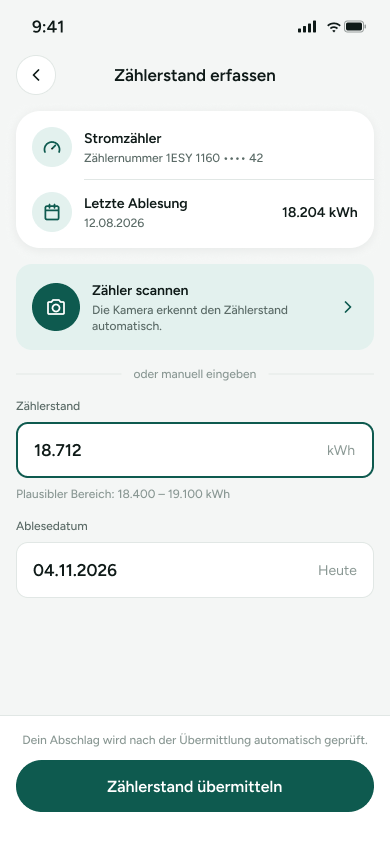

# 03 – Zählerstand erfassen

Screen zum Erfassen und Übermitteln eines Strom-Zählerstands. Die Nutzerin kann den Zähler scannen oder den Wert manuell eingeben und ein Ablesedatum sehen bzw. wählen.

> **Datenvertrag:** Abschnitte mit 🤖 hat die KI aus dem Screen abgeleitet. Sie sind ungeprüft.
> Abschnitte mit 📐 kommen direkt aus Figma.

## Letzte Änderung (2026-11-04)

Screen neu angelegt.

## CX · Kundenerlebnis 🤖

**Journey-Moment:** Kundin erfasst einen neuen Zählerstand zur Meldung an den Anbieter

**Was die Kundin erlebt:** Sie sieht ihren zugeordneten Stromzähler, die letzte Ablesung, einen Scan-Einstieg und die manuelle Eingabe des aktuellen Zählerstands mit Datum.

**Tonalität:** sachlich, unterstützend, leicht beruhigend

**Mögliche Reibungspunkte:**
- vermutlich unklar, ob der Scan direkt startet oder nur zu einer nächsten Ansicht führt
- vermutlich kann die Angabe des plausiblen Bereichs verunsichern, wenn der Wert außerhalb liegt
- vermutlich ist nicht ersichtlich, ob das Ablesedatum bearbeitbar ist oder automatisch gesetzt wird
- vermutlich fehlt ein Hinweis, was passiert, wenn der Zählerstand nicht plausibel ist

## RE · Anforderungen

**Aktionen** 🤖
- Zähler scannen auswählen
- Zählerstand manuell eingeben
- Ablesedatum ansehen oder vermutlich ändern
- Zählerstand übermitteln

**Eingabefelder** 🤖
- Zählerstand: numerische Eingabe mit Einheit kWh
- Ablesedatum: Datumseingabe

**Zustände** 🤖
- Zu sehen: Normalzustand mit vorausgefülltem Zählerstand, Hinweis auf plausiblen Bereich, Hinweistext zur automatischen Prüfung nach Übermittlung
- Vermutlich noch zu gestalten: Ladezustand für Scan, Fehlerzustand bei unplausiblem Zählerstand, Fehlerzustand bei ungültigem Datum, Erfolgszustand nach Übermittlung

**Navigation** 📐
- Kommt von: –
- Führt zu: –

## BA · Geschäftsregeln 🤖

**Angezeigte Daten:**
- Zählerbezeichnung: Stromzähler
- Zählernummer: 1ESY 1160 •••• 42
- Letzte Ablesung: 12.08.2026
- Letzter Zählerstand: 18.204 kWh
- Aktueller Zählerstand: 18.712 kWh
- Plausibler Bereich: 18.400 – 19.100 kWh
- Ablesedatum: 04.11.2026

**Vermutete Regeln:**
- vermutlich muss der eingegebene Zählerstand im plausiblen Bereich liegen oder wird geprüft
- vermutlich wird nach Übermittlung der Abschlag automatisch auf Plausibilität geprüft
- vermutlich ist nur ein Stromzähler pro Screen-Kontext relevant

## QA · Tests

**Testfälle** 🤖
- Screen zeigt die Zählernummer mit maskiertem Mittelteil korrekt an
- Letzte Ablesung und letzter Zählerstand werden korrekt dargestellt
- Zählerstand kann manuell mit Dezimal-/Tausenderformat angezeigt werden
- Ablesedatum zeigt das Datum im dargestellten Format
- Plausibler Bereich wird sichtbar angezeigt
- Button 'Zählerstand übermitteln' ist sichtbar
- Zustand mit vorausgefüllten Werten wird korrekt geladen

**Exakte Texte auf dem Screen** 📐
- 9:41
- Zählerstand erfassen
- Stromzähler
- Zählernummer 1ESY 1160 •••• 42
- Letzte Ablesung
- 12.08.2026
- 18.204 kWh
- Zähler scannen
- Die Kamera erkennt den Zählerstand automatisch.
- oder manuell eingeben
- Zählerstand
- 18.712
- kWh
- Plausibler Bereich: 18.400 – 19.100 kWh
- Ablesedatum
- 04.11.2026
- Heute
- Dein Abschlag wird nach der Übermittlung automatisch geprüft.
- Zählerstand übermitteln

## Dev · Umsetzung

**Komponenten aus dem Designsystem** 📐
- Status Bar
- Header/Detail
- Icon Button
- Icon/ChevronLeft
- List Row
- Icon/Meter
- Icon/Calendar
- Icon/Camera
- Icon/ChevronRight
- Input Field
- Button

**Datenfelder** 🤖
- zählerbezeichnung
- zählernummer_maskiert
- letzte_ablesung_datum
- letzter_zaehlerstand_kwh
- aktueller_zaehlerstand_kwh
- plausibler_bereich_min_kwh
- plausibler_bereich_max_kwh
- ablesedatum

**Hinweise** 🤖
- Input Field für Zählerstand mit Einheit kWh rechts
- List Row-Komponenten für Zählerinfo und letzte Ablesung
- Icon/Button für Scan-Einstieg mit ChevronRight
- Bottom-Bereich mit Hinweistext und Primärbutton
- vermutlich Validierung für Zahlenformat und Datumsformat nötig

**Dev Mode:** [in Figma öffnen](https://www.figma.com/design/NpRSQ1rdXPvYjjxzDiTjBC?node-id=20-1444&m=dev)

## Analytics · Messung

**Klickbare Elemente (Prototyp)** 📐
- keine Prototyp-Verbindungen in Figma

**Vorgeschlagene Events** 🤖
- screen_view_zählerstand_erfassen
- klick_zähler_scannen
- eingabe_zaehlerstand
- eingabe_ablesedatum
- klick_zählerstand_übermitteln

**Funnel-Position** 🤖 3 von 5 im Strom-App-Flow, zwischen Verbrauch und Abschlag anpassen

## PL · Stand

| | |
|---|---|
| **Status** | beschlossen |
| **Flow** | Screens – Strom-App (Screen 3 von 5) |
| **Alle Screens im Flow** | 01 – Übersicht → 02 – Verbrauch → 03 – Zählerstand erfassen → 04 – Abschlag anpassen → 05 – Vertrag |
| **Zuletzt geändert** | 2026-11-04 |
| **Figma** | [Screen öffnen](https://www.figma.com/design/NpRSQ1rdXPvYjjxzDiTjBC?node-id=20-1444) |

**Offene Fragen** 🤖
- Ist 'Ablesedatum' editierbar oder nur informativ?
- Startet 'Zähler scannen' direkt die Kamera oder öffnet es einen Zwischenschritt?
- Welche Fehlermeldung erscheint bei unplausiblem Zählerstand?
- Wird die Übermittlung erst bei gültigem Wert aktiv?
