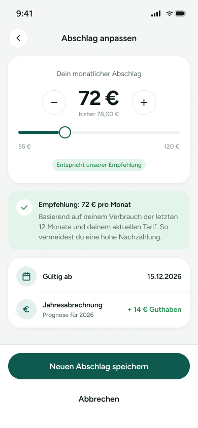

# 04 – Abschlag anpassen

Screen zum Anpassen des monatlichen Strom-Abschlags. Nutzer:innen können den Abschlag über Plus/Minus bzw. einen Slider ändern und sehen direkt eine Empfehlung sowie die Auswirkungen auf die Jahresabrechnung.

> **Datenvertrag:** Abschnitte mit 🤖 hat die KI aus dem Screen abgeleitet. Sie sind ungeprüft.
> Abschnitte mit 📐 kommen direkt aus Figma.

## Letzte Änderung (2026-11-04)

Screen neu angelegt.

## CX · Kundenerlebnis 🤖

**Journey-Moment:** Kundin passt den Abschlag vor der nächsten Abrechnung an

**Was die Kundin erlebt:** Die Kundin sieht den aktuellen und einen empfohlenen monatlichen Abschlag und kann den Betrag anpassen. Zusätzlich werden Gültigkeitsdatum und eine Prognose für die Jahresabrechnung angezeigt.

**Tonalität:** sachlich, unterstützend, beruhigend

**Mögliche Reibungspunkte:**
- vermutlich ist nicht klar, ob der Slider oder Plus/Minus direkt den Betrag ändert
- vermutlich fehlt eine Rückmeldung, was nach dem Speichern passiert
- vermutlich könnte unklar sein, ob der empfohlene Betrag verbindlich ist oder nur ein Hinweis
- vermutlich ist nicht ersichtlich, ob der Betrag sofort validiert wird

## RE · Anforderungen

**Aktionen** 🤖
- Abschlag per Minus reduzieren
- Abschlag per Plus erhöhen
- Abschlag über Slider anpassen
- Neuen Abschlag speichern
- Abbrechen

**Eingabefelder** 🤖
- Abschlag-Betrag über Slider/Schrittsteuerung

**Zustände** 🤖
- Zu sehen: Normalzustand, Empfehlungszustand hervorgehoben, Prognose sichtbar
- Vermutlich noch zu gestalten: vermutlich Fehlerzustand bei ungültigem Betrag, vermutlich Ladezustand beim Speichern, vermutlich Bestätigung nach erfolgreichem Speichern

**Navigation** 📐
- Kommt von: –
- Führt zu: –

## BA · Geschäftsregeln 🤖

**Angezeigte Daten:**
- Aktueller monatlicher Abschlag: 72 €
- Bisheriger Abschlag: 78,00 €
- Mindestwert am Slider: 55 €
- Höchstwert am Slider: 120 €
- Empfehlung: 72 € pro Monat
- Gültig ab: 15.12.2026
- Jahresabrechnung: Prognose für 2026
- + 14 € Guthaben

**Vermutete Regeln:**
- vermutlich ist der empfohlene Abschlag aus Verbrauch der letzten 12 Monate und aktuellem Tarif berechnet
- vermutlich wird der neue Abschlag nur innerhalb des sichtbaren Bereichs 55 € bis 120 € zugelassen
- vermutlich gilt die angezeigte Prognose für die gewählte Abschlagshöhe
- vermutlich wird der neue Abschlag ab dem angegebenen Datum wirksam

## QA · Tests

**Testfälle** 🤖
- Initialwert 72 € wird angezeigt
- Bisheriger Wert 78,00 € wird korrekt dargestellt
- Plus und Minus ändern den Abschlag innerhalb der Grenzen
- Slider lässt sich nur zwischen 55 € und 120 € bewegen
- Badge 'Entspricht unserer Empfehlung' erscheint beim empfohlenen Wert
- Empfehlungsbox zeigt Text und Guthaben-Prognose korrekt
- Gültig-ab-Datum wird korrekt angezeigt
- Speichern-Button ist sichtbar und beschriftet
- Abbrechen ist sichtbar und klickbar
- vermutlich keine Anzeige außerhalb des Wertebereichs

**Exakte Texte auf dem Screen** 📐
- 9:41
- Abschlag anpassen
- Dein monatlicher Abschlag
- 72 €
- bisher 78,00 €
- 55 €
- 120 €
- Entspricht unserer Empfehlung
- Empfehlung: 72 € pro Monat
- Basierend auf deinem Verbrauch der letzten 12 Monate und deinem aktuellen Tarif. So vermeidest du eine hohe Nachzahlung.
- Gültig ab
- 15.12.2026
- Jahresabrechnung
- Prognose für 2026
- + 14 € Guthaben
- Neuen Abschlag speichern
- Abbrechen

## Dev · Umsetzung

**Komponenten aus dem Designsystem** 📐
- Status Bar
- Header/Detail
- Icon Button
- Icon/ChevronLeft
- Icon/Minus
- Icon/Plus
- Badge
- Icon/Check
- List Row
- Icon/Calendar
- Icon/Euro
- Button

**Datenfelder** 🤖
- current_monthly_advance_amount
- previous_monthly_advance_amount
- advance_min_amount
- advance_max_amount
- recommended_advance_amount
- recommendation_reason_text
- valid_from_date
- annual_statement_forecast_year
- annual_statement_forecast_balance

**Hinweise** 🤖
- Slider und Plus/Minus müssen denselben Betrag steuern
- Betrag und Formatierung mit Euro-Zeichen und Dezimaldarstellung konsistent halten
- Empfehlungs-Badge abhängig vom aktuellen Betrag ein-/ausblenden
- Prognose und Empfehlung sollten aus Backend-/Berechnungsdaten kommen
- CTA unten fix bzw. im Footer platziert

**Dev Mode:** [in Figma öffnen](https://www.figma.com/design/NpRSQ1rdXPvYjjxzDiTjBC?node-id=20-1469&m=dev)

## Analytics · Messung

**Klickbare Elemente (Prototyp)** 📐
- keine Prototyp-Verbindungen in Figma

**Vorgeschlagene Events** 🤖
- klick_abschlag_minus
- klick_abschlag_plus
- slider_abschlag_change
- klick_neuen_abschlag_speichern
- klick_abbrechen

**Funnel-Position** 🤖 Mitte des Self-Service-Flows: Anpassung des Abschlags vor Abschluss

## PL · Stand

| | |
|---|---|
| **Status** | beschlossen |
| **Flow** | Screens – Strom-App (Screen 4 von 5) |
| **Alle Screens im Flow** | 01 – Übersicht → 02 – Verbrauch → 03 – Zählerstand erfassen → 04 – Abschlag anpassen → 05 – Vertrag |
| **Zuletzt geändert** | 2026-11-04 |
| **Figma** | [Screen öffnen](https://www.figma.com/design/NpRSQ1rdXPvYjjxzDiTjBC?node-id=20-1469) |

**Offene Fragen** 🤖
- Was passiert nach 'Neuen Abschlag speichern' genau?
- Ist der Abschlag-Bereich 55 € bis 120 € hart begrenzt?
- Wie wird die Prognose für die Jahresabrechnung berechnet?
- Ist 'Gültig ab 15.12.2026' immer fest oder dynamisch?
- Was bedeutet 'Entspricht unserer Empfehlung' genau bei anderen Werten?
