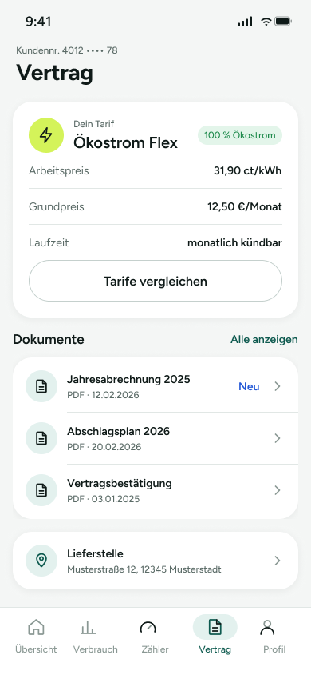

# 05 – Vertrag

Vertragsübersicht mit Tarifdaten, Dokumentenliste und Lieferstellen-Informationen. Der Screen dient vermutlich dazu, Vertragsdetails schnell einzusehen und weiterführende Dokumente aufzurufen.

> **Datenvertrag:** Abschnitte mit 🤖 hat die KI aus dem Screen abgeleitet. Sie sind ungeprüft.
> Abschnitte mit 📐 kommen direkt aus Figma.

## Letzte Änderung (2026-11-04)

Screen neu angelegt.

## CX · Kundenerlebnis 🤖

**Journey-Moment:** Kundin prüft Vertrags- und Tarifdetails im eingeloggten Bereich

**Was die Kundin erlebt:** Die Kundin sieht ihre Vertragsdaten, kann Dokumente einsehen und die Lieferstelle prüfen.

**Tonalität:** sachlich, informativ, übersichtlich

**Mögliche Reibungspunkte:**
- Die Funktion von „Tarife vergleichen“ ist ohne Kontext nur indirekt verständlich.
- „Neu“ bei der Jahresabrechnung 2025 kann Aufmerksamkeit erzeugen, obwohl unklar ist, was genau neu ist.
- Ob die Dokumente direkt geöffnet werden oder erst eine Liste folgt, ist aus dem Screen allein nicht klar.

## RE · Anforderungen

**Aktionen** 🤖
- Tarife vergleichen
- Alle anzeigen bei Dokumenten
- einzelne Dokumente in der Liste öffnen
- Lieferstelle öffnen

**Eingabefelder** 🤖
- keine

**Zustände** 🤖
- Zu sehen: Normalzustand, Badge „Neu“ bei einem Dokument
- Vermutlich noch zu gestalten: Leerzustand für Dokumente, Fehlerzustand beim Laden der Vertragsdaten, Ladezustand für Dokumente, Zustand für fehlende Lieferstellen- oder Tarifdaten

**Navigation** 📐
- Kommt von: –
- Führt zu: –

## BA · Geschäftsregeln 🤖

**Angezeigte Daten:**
- Kundennr. 4012 •••• 78
- Tarif: Ökostrom Flex
- Kennzeichnung: 100 % Ökostrom
- Arbeitspreis: 31,90 ct/kWh
- Grundpreis: 12,50 €/Monat
- Laufzeit: monatlich kündbar
- Dokument: Jahresabrechnung 2025, PDF · 12.02.2026, Badge „Neu“
- Dokument: Abschlagsplan 2026, PDF · 20.02.2026
- Dokument: Vertragsbestätigung, PDF · 03.01.2025
- Lieferstelle: Musterstraße 12, 12345 Musterstadt

**Vermutete Regeln:**
- Dokumente sind vermutlich nach Datum oder fachlicher Relevanz sortiert.
- Der Badge „Neu“ markiert vermutlich ein noch nicht angesehenes Dokument.
- Die Kundennummer ist teilweise maskiert dargestellt.
- Die Lieferstelle gehört vermutlich zum aktuellen Vertrag.

## QA · Tests

**Testfälle** 🤖
- Tarifkarte zeigt alle drei Tarifdaten korrekt an.
- Dokumentenliste zeigt drei Einträge mit Titel, Dateityp und Datum.
- Badge „Neu“ wird nur beim ersten Dokument angezeigt.
- „Alle anzeigen“ ist sichtbar und ansteuerbar.
- Tab Bar markiert „Vertrag“ als aktiven Bereich.
- Lieferstellen-Karte zeigt Adresse korrekt an.
- Kundennummer wird teilweise maskiert dargestellt.

**Exakte Texte auf dem Screen** 📐
- 9:41
- Kundennr. 4012 •••• 78
- Vertrag
- Dein Tarif
- Ökostrom Flex
- 100 % Ökostrom
- Arbeitspreis
- 31,90 ct/kWh
- Grundpreis
- 12,50 €/Monat
- Laufzeit
- monatlich kündbar
- Tarife vergleichen
- Dokumente
- Alle anzeigen
- Jahresabrechnung 2025
- PDF · 12.02.2026
- Neu
- Abschlagsplan 2026
- PDF · 20.02.2026
- Vertragsbestätigung
- PDF · 03.01.2025
- Lieferstelle
- Musterstraße 12, 12345 Musterstadt
- Übersicht
- Verbrauch
- Zähler
- Profil

## Dev · Umsetzung

**Komponenten aus dem Designsystem** 📐
- Status Bar
- Header/Main
- Icon/Bolt
- Badge
- Button
- List Row
- Icon/Document
- Icon/ChevronRight
- Icon/MapPin
- Tab Bar
- Tab Item
- Icon/Home
- Icon/Chart
- Icon/Meter
- Icon/User

**Datenfelder** 🤖
- kundennummer_maskiert
- tarifname
- oekostrom_label
- arbeitspreis
- grundpreis
- laufzeit
- dokumente[{titel,dateityp,datum,neu_flag}]
- lieferstelle_adresse
- aktive_tab

**Hinweise** 🤖
- List Row und Button aus dem Designsystem verwenden.
- Chevron signalisiert Navigation zu Detailansichten.
- Badge nur bei gesetztem Neu-Status rendern.
- Tab Bar mit aktivem Tab „Vertrag“ vorselektieren.

**Dev Mode:** [in Figma öffnen](https://www.figma.com/design/NpRSQ1rdXPvYjjxzDiTjBC?node-id=20-1504&m=dev)

## Analytics · Messung

**Klickbare Elemente (Prototyp)** 📐
- keine Prototyp-Verbindungen in Figma

**Vorgeschlagene Events** 🤖
- klick_tarife_vergleichen
- klick_dokument_oeffnen
- klick_alle_dokumente
- klick_lieferstelle
- klick_tab_vertrag

**Funnel-Position** 🤖 letzter Screen im Flow – Vertragsübersicht

## PL · Stand

| | |
|---|---|
| **Status** | beschlossen |
| **Flow** | Screens – Strom-App (Screen 5 von 5) |
| **Alle Screens im Flow** | 01 – Übersicht → 02 – Verbrauch → 03 – Zählerstand erfassen → 04 – Abschlag anpassen → 05 – Vertrag |
| **Zuletzt geändert** | 2026-11-04 |
| **Figma** | [Screen öffnen](https://www.figma.com/design/NpRSQ1rdXPvYjjxzDiTjBC?node-id=20-1504) |

**Offene Fragen** 🤖
- Öffnen die Dokumente direkt ein PDF oder eine Detailseite?
- Wohin führt „Alle anzeigen“ genau?
- Welche Bedeutung hat „Neu“ fachlich?
- Ist „Tarife vergleichen“ eine interne Vergleichsseite oder ein externer Flow?
